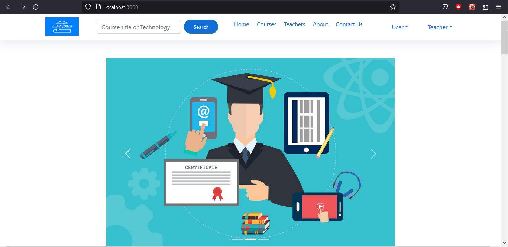

# E-Learning Platform

[](https://github.com/RachidAifar/E-Learningwebsite/actions/workflows/ci.yml)

A full-stack e-learning web application: teachers create courses, chapters, quizzes and study materials; students enrol, take quizzes, track assignments and get course recommendations.

**Stack:** React 18 · Django 4.2 + Django REST Framework · PostgreSQL · pandas + scikit-learn



## Features

**Students**
- Register, log in, edit profile, change password
- Browse and search courses by title or technology, view course details and chapters
- Enrol in courses, rate courses, save favourites
- Take quizzes and see results; view assignments and study materials
- **Course recommendations** based on content similarity (see below)

**Teachers**
- Register, log in, manage profile and skills
- Create and edit courses, chapters (with videos), quizzes and quiz questions
- Assign quizzes to courses, upload study materials, give assignments
- See enrolled students and quiz results

### Course recommendations
`main/recommendation_engine.py` recommends courses similar to a given one. It turns each course's technologies into **TF-IDF vectors** (scikit-learn) and ranks the other courses by **cosine similarity**. Endpoint: `GET /api/recommend/<course_id>/`.

## Architecture

```
React (e-learning-front-end/)  ──HTTP/JSON──▶  Django REST API (main/)  ──▶  PostgreSQL
  pages, dashboards, forms                      models, serializers,          (SQLite fallback
  axios calls to /api/...                       views, recommendation engine   for quick local runs)
```

## Run it locally

### Backend (Django)
Requires Python 3.12.

```bash
python -m venv .venv
source .venv/bin/activate        # Windows: .venv\Scripts\activate
pip install -r requirements.txt

cp .env.example .env             # then edit the values
python manage.py migrate
python manage.py createsuperuser # optional, for /admin
python manage.py runserver       # http://127.0.0.1:8000
```

**Database:** if `POSTGRES_DB` is set in `.env`, Django uses PostgreSQL with the `POSTGRES_*` settings. If it is empty, it uses a local SQLite file, so you can try the project without installing PostgreSQL.

### Frontend (React)
Requires Node.js 18 or newer.

```bash
cd e-learning-front-end
npm ci
npm start                        # http://localhost:3000
```

The frontend calls the API at `http://127.0.0.1:8000/api`.

## Tests

```bash
# Backend: 17 tests (accounts, password security, courses, search, recommendations)
python manage.py test main

# Frontend: React Testing Library + Jest (login, registration, course card)
cd e-learning-front-end
npx react-scripts test --watchAll=false
```

GitHub Actions runs both on every push: the backend tests against a real **PostgreSQL 16** service, plus a migrations check, and the frontend tests and production build.

Notable regression tests in `main/tests.py`:
- Saving a profile must not re-hash the stored password (this used to lock users out).
- Changing a password must store a hash, never plain text.
- API responses must never include the password hash.

## Project structure

```
eLearning/              Django project settings and URLs
main/                   Django app: models, serializers, views, recommendation engine, tests
e-learning-front-end/   React app (components, routes, dashboards, tests in src/__tests__)
Images_Result/          Screenshots
```

## Security notes
- Passwords are hashed with Django's password hashers; secrets and database credentials come from environment variables (`.env`, never committed).
- **Known limitations, planned next:** login currently returns the user id and the frontend keeps the session in `localStorage`; several endpoints are `csrf_exempt`. The next step is proper token-based authentication (DRF tokens or JWT) and permission checks on the API.

## Roadmap
- Token authentication and per-user permissions on the API
- Clean up the remaining ESLint warnings (unused imports, hook dependencies)
- Docker Compose setup (Django + PostgreSQL + React)
